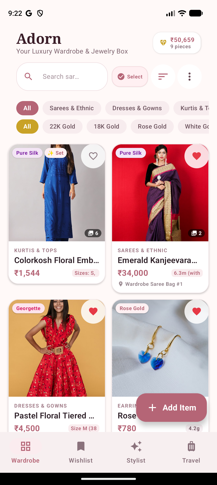
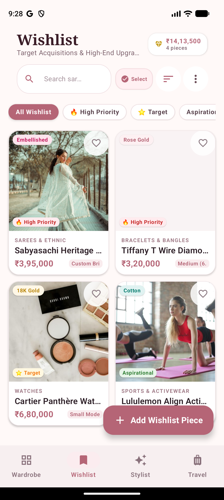
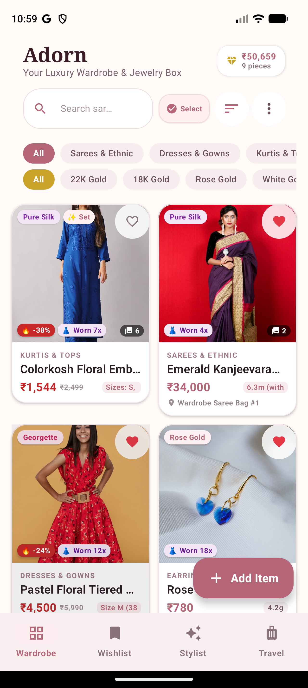
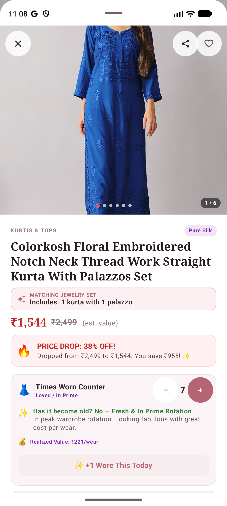
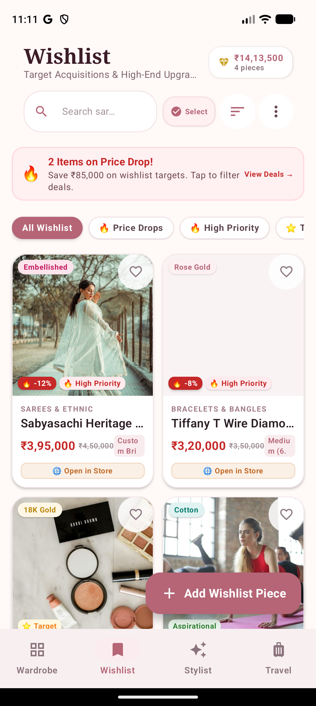
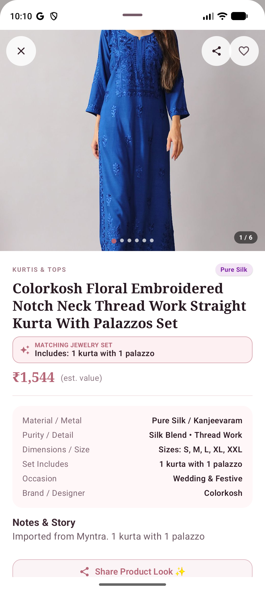
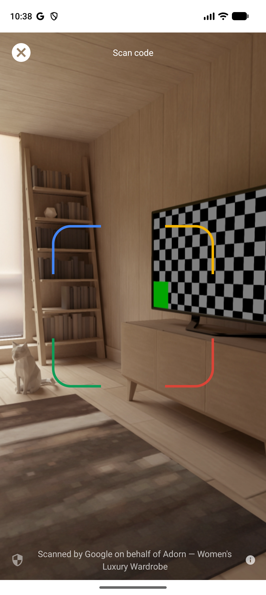
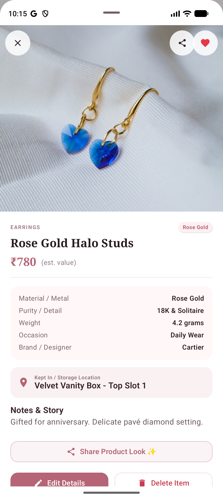
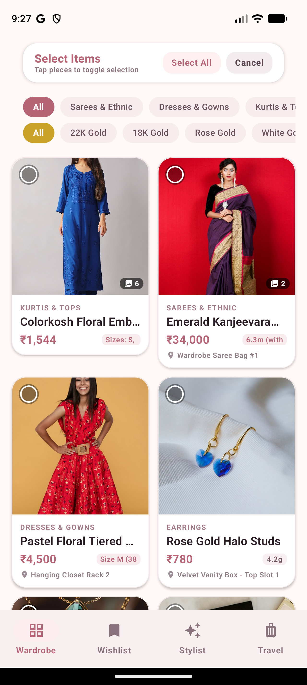
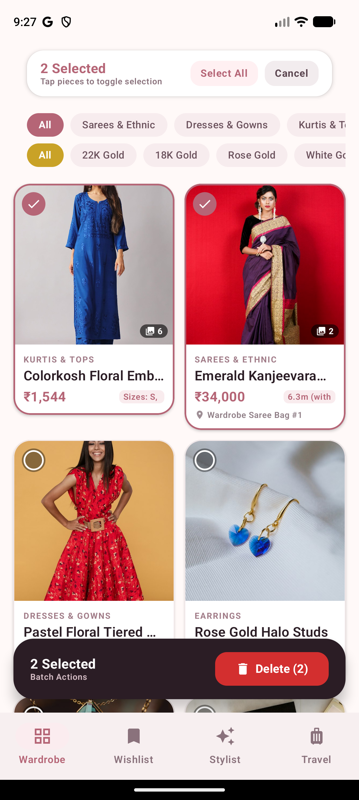

# Adorn — Women's Luxury Wardrobe, Jewelry Box & AI Stylist 👗💎👜

[](https://www.android.com/)
[](https://kotlinlang.org/)
[](https://developer.android.com/jetpack/compose)
[](https://developers.google.com/ml-kit)
[]()

**Adorn** is a luxury digital boutique closet and styling dashboard built natively for Android using **Jetpack Compose**, **Material 3**, and modern Kotlin MVVM architecture. Designed specifically for women to digitize, catalog, value, style, and track their entire wardrobe: **haute couture & Indian ethnic wear (sarees, lehengas, anarkalis, kurtis, gowns, activewear), fine gold & diamond jewelry (earrings, necklaces, bangles, rings), luxury designer handbags, and collector timepieces**.

---

## 📱 Live App Screenshots

### 1. Boutique Vault & Curated Wishlist

| 👗 Main Wardrobe & Gallery | 🛍️ Dedicated Wishlist & Target Budget |
| :---: | :---: |
|  |  |
| *Real-time collection valuation (₹), category chips, quick search, and multi-select* | *Aspirational pieces, priority tiers (🔥 High, ⭐ Target), and total wishlist budget* |

---

### 2. Wear & Aging Intelligence & Deep Product Detail

| ⏳ Wear & Aging Engine | 🔍 Luxury Product Detail Sheet |
| :---: | :---: |
|  |  |
| *Cost-per-wear tracker, interactive wear count stepper (+/-), "Wore Today" logger, and garment aging status* | *Multi-photo carousel, fabric & jewelry specifications, storage location, and quick actions* |

---

### 3. Price Drop Radar & Native System Share Sheet

| 🏷️ Price Drop Radar & Savings | 📤 Native System Share Sheet |
| :---: | :---: |
|  |  |
| *Original vs current price tracking, % OFF badge, total savings calculation, and 1-tap browser store opener* | *Seamlessly share pieces, gift links, and style notes across WhatsApp, Instagram, Messages, and Drive* |

---

### 4. Barcode Scanner & Rapid Item Digitizer

| 📷 Real-Time Barcode & QR Scanner | 📝 Full-Featured Add / Edit Dialog |
| :---: | :---: |
|  |  |
| *CameraX & ML Kit powered scanner for instant retail tags, SKU barcodes, and product QR codes* | *Category-specific spec forms, size pills, photo picker, and direct Myntra/web image downloader* |

---

### 5. Multi-Select & Batch Operations

| 🔘 Multi-Select Mode | 🗑️ Batch Deletion & Promotion Bar |
| :---: | :---: |
|  |  |
| *Tap 'Select' or long-press cards with rose-gold checkmarks and selected counter* | *Floating frosted glass action bar for bulk deletion or 1-tap migration to active wardrobe* |

---

## 🌟 Comprehensive Feature Set

### 1. Clothes & Ethnic Wear Management 👗🥻
- **Specialized Clothing Categories**:
  - `Sarees & Ethnic`: Silk sarees, Kanjeevarams, bridal lehengas, Banarasis, anarkalis.
  - `Dresses & Gowns`: Midi dresses, evening gowns, maxi dresses, cocktail attire.
  - `Kurtis & Tops`: Daily kurtas, embroidered tunic tops, office shirts.
  - `Bottoms & Skirts`: Palazzos, lehenga skirts, straight trousers, pants.
  - `Sports & Activewear`: Gym sets, yoga leggings, athletic tops, seamless dry-fit wear.
- **Fabrics & Materials**:
  - `Pure Silk / Kanjeevaram`, `Cotton & Linen`, `Georgette / Organza / Chiffon`, `Velvet & Satin`, `Spandex / Technical Athletic`.
- **Intelligent Sizing Engine**:
  - One-tap quick size pills: `XS (34)`, `S (36)`, `M (38)`, `L (40)`, `XL (42)`, `Free Size`, `6.3m Saree (with blouse)`.
  - Custom tailoring sizing support for bespoke designer ethnic wear.

---

### 2. Fine Jewelry Box & Precious Stones 💎✨
- **Precious Metals & Purity**: `24K Pure Gold`, `22K Traditional Yellow Gold`, `18K Rose Gold`, `Platinum`, `925 Sterling Silver`.
- **Gemstones & Diamonds**: Solitaire diamonds, emeralds, rubies, polki, kundan, pearls.
- **Jewelry Sizing Specifications**:
  - *Chains & Necklaces*: `16" Choker`, `18" Princess`, `20" Matinee`, `24" Opera`.
  - *Bangles & Kadas*: Traditional Indian sizing (`2.4`, `2.6`, `2.8`) and wrist circumference (`7.0" Wrist`).
  - *Rings*: Dual Indian & US ring sizing (`Size 12 Indian / 6 US`).
- **Matching Sets & Combos**: Single-tap set flag with combo tags (`Necklace + Earrings`, `Choker + Jhumkas`, `Full Bridal Set`) featuring a luxury rose-gold badge.

---

### 3. Smart Wear & Aging Engine ⏳💰
- **Cost-Per-Wear (CPW) Intelligence**:
  $$\text{Cost Per Wear} = \frac{\text{Purchase Valuation}}{\text{Total Times Worn}}$$
  Dynamically demonstrates real cost-efficiency as you wear your wardrobe pieces.
- **Interactive Wear Counter Stepper**:
  - Increment (`+`) and decrement (`-`) wear counts directly within the item detail view.
- **"Wore Today" Instant Button**:
  - One-tap button that increments wear count and timestamps today's date into the item history log.
- **Garment Aging Tracker**:
  - Monitors the item's age since acquisition (`Fresh / Like New`, `Regular Rotation`, `Vintage / Archive`).

---

### 4. Price Drop Radar & Savings Analytics 📉🏷️
- **Real-Time Discount Detection**:
  - Compares original retail price with current effective price.
  - Automatically renders a high-visibility badge displaying percentage discount (`% OFF`) and exact currency saved (e.g. `Save ₹3,000`).
- **Wishlist Filter Chips**:
  - Filter by `🔥 High Priority`, `⭐ Target`, and `📉 Price Drops Only`.
- **Direct Store Launcher**:
  - Deep-links directly to Amazon, Myntra, Nykaa, or brand boutique with a single tap.

---

### 5. Barcode & QR Code Scanner 📷⚡
- Embedded **CameraX** view with Google **ML Kit Barcode Scanning**.
- Instantly detects retail tag barcodes (EAN-13, UPC-A, Code 128) and QR codes to auto-populate product names, SKUs, and retail links.

---

### 6. AI Stylist Studio ✨👠
- **Anchor Piece Selection**: Pick any saree, gown, or kurti from your wardrobe as the foundation.
- **Ensemble Coordination**:
  - AI heuristic engine coordinates your outfit with matching jewelry sets, earrings, chains, handbags, and watches from your own existing wardrobe.
  - Harmony score calculation based on color harmony, metal matching, and occasion intelligence.
- **Future-Ready Architecture**:
  - Clean `JewelrySuggestionApiService` interface ready for Gemini Vision or custom cloud models.

---

### 7. Travel & Trip Packing Checklist 🧳🏡
- **Before-Trip Packing**: Select and check off outfits and jewelry into travel pouches.
- **Safe-Return Mode**: Verification checklist when returning home with location reminders (e.g., *"Return to: Velvet Vanity Box - Top Slot 1"*).
- **Security Alerts**: Warns if any high-value jewelry or designer piece remains unpacked.

---

### 8. Native System Share Sheet 📤
- Integrated Android `ACTION_SEND` intent with styled plain-text summaries:
  - Formats product name, brand, category, valuation, size, specs, and store URL.
  - Share directly to WhatsApp, Telegram, Instagram, Messages, or Google Keep.

---

## 🛠️ Architecture & Tech Stack

```
app/src/main/java/com/adorn/wardrobe/
├── data/
│   ├── model/           # WardrobeItem, WishlistItem, CuratedLook, TripPlan
│   └── repository/      # In-memory & Room DB persistence, JSON serializers
├── ui/
│   ├── theme/           # LuxuryTheme: Blush pink, rose gold, champagne gold, obsidian
│   ├── components/      # ItemCard, PriceDropBadge, WearStepper, BarcodeScannerView
│   ├── screens/         # WardrobeScreen, WishlistScreen, StylistScreen, TravelScreen
│   └── viewmodel/       # WardrobeViewModel (StateFlow reactive unidirectional data flow)
└── util/
    ├── ImageDownloader  # Direct web image fetcher and persistent file storage
    └── BarcodeAnalyzer  # CameraX ML Kit ImageAnalysis analyzer
```

- **UI Framework**: 100% Jetpack Compose with Material 3 styling.
- **Image Pipeline**: Coil (Coroutines Image Loader) + local disk cache.
- **Scanner Pipeline**: CameraX `1.3.4` + Google ML Kit `barcode-scanning:17.3.0`.
- **Target SDK**: Android 14 / 15 (API 34 / 35).
- **Min SDK**: Android 8.0 (API 26).

---

## 🚀 Building & Running

### Prerequisites
- **Android Studio**: Ladybug / Koala or newer.
- **JDK**: Version 17+.
- **Android Device / Emulator**: Running Android 8.0 (API 26) or higher.

### Quick Start
```bash
# Clone the repository
git clone https://github.com/Amara-Manikanta/Adorn-Women-s-Dashboard.git
cd Adorn-Women-s-Dashboard

# Build Debug APK
./gradlew assembleDebug

# Install directly to connected device
./gradlew installDebug
```

---

## 📄 License
This project is proprietary and developed for personal wardrobe and luxury portfolio management.
All rights reserved © Manikanta Amara.
